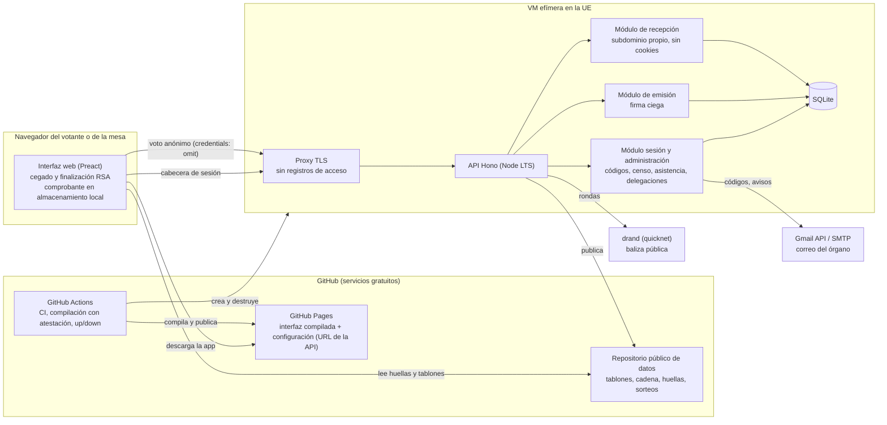

# Plan de `plataforma-votaciones`

> Estado: **borrador pendiente de aprobación**. Este documento resume y ordena las decisiones de [`entrevista.md`](entrevista.md). Cada decisión relevante tiene su registro en [`adr/`](adr/) y el análisis de seguridad está en [`modelo-amenazas.md`](modelo-amenazas.md). Las afirmaciones marcadas con **[por verificar]** no están confirmadas.

## 1. Visión

`plataforma-votaciones` es una aplicación web, pública y auditable, para las votaciones de un órgano colegiado de representación estudiantil. Su primer usuario será el Pleno del Consejo de Estudiantes de la Facultad de Ciencias, un electorado de unas 40–60 personas.

Objetivos, en este orden:

1. **Secreto del voto.** En las votaciones secretas, nadie (tampoco quien administra el servidor) debe poder saber qué votó cada persona a partir de los datos de la plataforma.
2. **Unicidad.** Cada voto con derecho se emite una sola vez.
3. **Verificabilidad.** Cada votante puede comprobar que su voto se contó tal como lo emitió, y cualquiera puede recalcular el resultado a partir de los datos publicados con una herramienta independiente.
4. **Fidelidad a las reglas.** Los quorums, las mayorías, los desempates y los algoritmos de asignación se aplican tal como los fija el perfil de reglas del órgano, y ese perfil se publica junto a cada resultado.
5. **Honestidad.** Lo que el sistema no protege está escrito con la misma claridad que lo que sí protege.

Restricciones: coste nulo o mínimo, mantenimiento por estudiantes que cambian cada curso y protección de datos con datos mínimos.

## 2. Alcance de la v1

Objetivo de fecha: estar en producción para un pleno ordinario del segundo cuatrimestre del curso 2026-27 (febrero–mayo de 2027). El uso real queda condicionado a la ratificación del Reglamento y a un acuerdo del Pleno que apruebe la plataforma (ver [ADR-0024](adr/0024-encaje-institucional.md)).

### Incluido

| Área | Contenido |
|---|---|
| Sesiones | Censo con titulaciones, asistencia presencial y telemática registrada por la mesa, primera y segunda convocatoria, quorum comprobado al abrir cada votación. |
| Delegación | Registro por la mesa, tope configurable (2 por defecto), suspensión si quien delega llega, papeletas separadas para la persona delegada. |
| Métodos de votación | Sí/no con umbral configurable; elección uninominal con segunda vuelta; candidaturas en bloque; asignación de vocalías por aceptación diferida; voto limitado con suplentes; mayoría relativa para un puesto; asentimiento con plazo. |
| Modalidades | Secreta electrónica (firmas ciegas), nominal electrónica, recuento manual (mano alzada) y papel (totales introducidos por la mesa). |
| Momento | En directo durante la sesión y en el enlace único al terminar la sesión, con un plazo fijado al abrir. |
| Sorteos | Verificables, con compromiso de la mesa y baliza pública drand. |
| Publicación | Tablón público desagregado por casilla, cadena de hashes, archivo estático permanente y exportación para el acta. |
| Verificación | Comprobante individual y CLI independiente en Python. |
| Interfaz | Español e inglés, móvil primero, WCAG 2.2 AA, vista de proyección. |

### Excluido

- Elecciones a delegación y subdelegación de grupo (otro censo, otra escala y otro órgano responsable). No hay previsión en el diseño.
- Instancias con varias organizaciones: cada órgano despliega su propia instancia.
- Gestionar dentro de la plataforma la petición de voto secreto, las firmas de una moción de censura y la restricción a quienes firmaron una moción rechazada.
- Integración con la videollamada y SSO de la Universidad (mejora futura).
- Revoto: un token es un voto.

## 3. Glosario mínimo

| Término | Significado en este proyecto |
|---|---|
| **Mesa** | Rol que crea, abre y cierra votaciones y registra asistencia y delegaciones (1–3 personas). |
| **Perfil** | Archivo versionado con los parámetros del órgano (quorums, topes, plazos, textos). |
| **Método** | Algoritmo de recuento del catálogo cerrado (p. ej., «sí/no», «uninominal»). |
| **Derecho de voto** | Cada voto que una persona puede emitir en una votación: el suyo y uno por cada delegación vigente. |
| **Token** | Mensaje aleatorio que el servidor firma «a ciegas»; con su firma, autoriza un único voto anónimo. |
| **Credencial** | Token más firma válida. |
| **Casilla** | Unidad mínima de respuesta de una papeleta (p. ej., «candidatura X en la vocalía Y»). |
| **Tablón** | Publicación de una votación cerrada: participación, listas por casilla, contadores, reglas y hash. |
| **Foto de presentes** | Lista congelada de presentes (y sus derechos) en el momento de abrir una votación. |

## 4. Arquitectura

### 4.1 Componentes



### 4.2 Principios de diseño

- **El cliente no lo sirve el servidor de votos.** La interfaz se compila en GitHub Actions desde el repositorio público, se publica en GitHub Pages con atestación de procedencia y obtiene la URL de la API de un archivo de configuración. Una VM manipulada no puede servir un JavaScript distinto al votante ([ADR-0017](adr/0017-despliegue-vm-efimera-pages.md)).
- **Núcleo sin E/S.** `packages/core` contiene los métodos de recuento, los umbrales, los sorteos, el formato del tablón y la cadena de hashes como funciones puras. Lo usan la API, la interfaz (para la vista previa y la verificación) y las pruebas.
- **Módulos separados por propósito.** Emisión y recepción no comparten estado salvo la lista de tokens gastados. La recepción vive en otro subdominio, no acepta sesión y no registra nada. Están en el mismo proceso: separarlos en dos despliegues solo aportaría algo si los operasen personas distintas ([ADR-0004](adr/0004-desacople-emision-envio.md)).
- **VM efímera.** Se enciende antes de un pleno o de un asentimiento y se apaga después. Por defecto es una VM gratuita de Oracle Cloud en la UE; si la delegación o la facultad lo financian, una VM de pago de Hetzner, empresa de la UE. Todo lo público vive en GitHub y sigue disponible con la VM apagada ([ADR-0017](adr/0017-despliegue-vm-efimera-pages.md)).
- **Sin registros de acceso** en el proxy ni en la aplicación ([ADR-0018](adr/0018-sin-registros.md)).
- **Portabilidad.** Hono y Drizzle permiten el plan B (Render en Frankfurt + Neon en la UE) sin reescribir la lógica.

### 4.3 Repositorios

| Repositorio | Contenido | Quién escribe |
|---|---|---|
| `plataforma-votaciones` (código, este) | Monorepo, documentación y plan. | Contribuciones por PR. |
| Repositorio de datos (uno por instancia) | Archivo público: tablones, cadena, huellas, sorteos, configuración de la API. | Solo la VM, con un token de grano fino limitado a ese repositorio. |

Estructura del monorepo (pnpm workspaces):

```
apps/api/        API Hono (Node LTS)
apps/web/        Interfaz Preact + Vite (publicada en Pages)
packages/core/   Métodos, umbrales, sorteos, tablón, cadena (puro, sin E/S)
spec/            Especificación normativa y corpus JSON de casos
tools/verify/    CLI de verificación independiente (Python)
infra/           Scripts up/down, cloud-init, Docker Compose, adaptadores de proveedor
profiles/        Perfiles de reglas versionados (el del Pleno es el primero)
docs/            Documentación pública es/en
PLAN/            Este plan, ADR y modelo de amenazas
```

## 5. Modelo de datos

### 5.1 Qué se guarda (SQLite, en la VM)

| Entidad | Campos principales | Personal | Retención |
|---|---|---|---|
| `member` | id, nombre, correo, titulaciones[], activo | Sí | Hasta 1 mes tras la constitutiva siguiente |
| `census_change` | quién, qué, cuándo (registro interno) | Sí | Igual |
| `role_assignment` | miembro, rol `mesa`; registro público solo con alias de cargo | Sí (interno) | Igual |
| `auth_code` | miembro, hash del código, caducidad, intentos, `assisted_by` | Sí | Se borra al usarse o caducar (10 min) |
| `auth_session` | hash del token de sesión, miembro, caducidad | Sí | 12 h |
| `session` | título, estado, convocatoria (1.ª/2.ª), hora de la 2.ª, total de miembros congelado | No | Indefinida |
| `attendance_event` | sesión, miembro, entrada/salida, presencial/telemática, hora, mesa | Sí | Retención personal |
| `delegation` | sesión, quien delega, persona delegada, `justified` (sí/no), suspendida a las | Sí | Retención personal |
| `voting` | método, parámetros, hash de reglas, modalidad, secreta, estado, apertura/cierre, forzado y motivo, anulada y motivo | No | Indefinida |
| `electorate_snapshot` | votación, miembro, nº de derechos (1 + delegaciones vigentes) | Sí | Retención personal |
| `issuance` | votación, miembro, hash del mensaje cegado, firma ciega devuelta | Sí | Retención personal |
| `signing_key` | votación, clave pública, clave privada **cifrada**, `destroyed_at` | No | La privada se borra al cerrar |
| `ballot_received` | votación, token, firma, secreto `s`, respuestas | No identifica | **Se borra al publicar el tablón** |
| `spent_token` | votación, token | No | Indefinida (también en el tablón) |
| `nominal_vote` | votación no secreta, miembro, respuesta | Sí (público por naturaleza) | Retención personal; el resultado nominal va al acta |
| `paper_totals` | votación, totales por casilla, mesa | No | Indefinida |
| `assent` / `assent_opposition` | texto, envío, cierre / miembro, hora, retirada | Sí | Retención personal |
| `draw` | compromiso H(semilla), ronda drand, semilla revelada, resultado | No | Indefinida |
| `chain_record` | hash anterior, hash del tablón, hash del registro | No | Indefinida |

### 5.2 Qué NO se guarda (requisito, con pruebas)

- **Ninguna relación entre una persona y su token.** `issuance` guarda el mensaje cegado, que es estadísticamente independiente del token final (propiedad de ceguera de RFC 9474; ver la salvedad en [`modelo-amenazas.md`](modelo-amenazas.md)).
- **Ni hora ni orden de llegada de los votos.** `ballot_received` y `spent_token` son tablas `WITHOUT ROWID` con clave primaria en el token, sin columnas de tiempo ni autoincrementales. **[por verificar]** Los artefactos físicos de orden en SQLite (WAL, páginas libres): se mitigan con `secure_delete` y `VACUUM` tras el cierre, y se documentarán como residuo.
- **Ni IP, ni user-agent, ni cabeceras** en ningún registro. El proxy no tiene registro de acceso y la aplicación solo registra errores sin identificadores.
- **Ni la combinación completa de cada papeleta tras el cierre.** Al publicar, se borran `s` y las respuestas agrupadas, y solo quedan las listas por casilla.
- **Ni el motivo de una delegación**: solo «justificada: sí».
- **Ni requisitos académicos** (curso, asignaturas): los comprueba la mesa.
- **Ni contraseñas**: el acceso es por código de un solo uso, del que solo se guarda su hash.

## 6. Especificación del protocolo (votación secreta electrónica)

La especificación normativa, en inglés, está en [`spec/`](../spec/) desde el hito H2; prevalece sobre este resumen, que refina en algunos puntos (ver [`spec/README.md`](../spec/README.md#differences-from-the-plan)). Aquí está el resumen paso a paso. Notación: `H` = SHA-256, `‖` = concatenación y `JCS(x)` = serialización canónica RFC 8785.

### 6.1 Parámetros criptográficos

- RSA Blind Signatures, RFC 9474, variante **RSABSSA-SHA384-PSS-Randomized**, módulo de 3072 bits ([ADR-0002](adr/0002-libreria-variante-clave.md)).
- Librería: `@cloudflare/blindrsa-ts` en el navegador y para generar claves y verificar; la firma ciega del servidor usa OpenSSL ([ADR-0002](adr/0002-libreria-variante-clave.md)). Las firmas finales son RSA-PSS estándar y cualquier librería RSA las verifica.
- Una clave por votación ([ADR-0003](adr/0003-ciclo-de-vida-de-claves.md)).

### 6.2 Preparación (mesa)

1. La mesa crea la votación: método, parámetros, opciones y candidaturas (con un id estable), filtro de titulación y modalidad (en directo o en el enlace final). Las reglas efectivas (perfil + parámetros) se serializan con JCS y se calcula `rules_hash`.
2. Si el método usa un orden de desempate, la mesa genera una semilla y se publica `H(semilla)`. La ronda drand se fija en público antes de que exista: en el enlace final, la primera con hora ≥ el cierre fijado, publicada al abrir; en directo, unos 30 s después del cierre, mostrada en la proyección ([ADR-0015](adr/0015-sorteos-verificables.md)).
3. La votación no se puede editar. Solo se puede anular, con un motivo que se publica.

### 6.3 Apertura

1. Se toma la **foto de presentes**: miembros presentes que cumplen el filtro y, para cada uno, su número de derechos (1 más las delegaciones vigentes de personas del filtro). En el enlace final, la foto es la del momento de levantar la sesión (parámetro del perfil).
2. Se comprueban el quorum y la asistencia mínima del método. Si no se cumplen, la mesa puede **forzar** la apertura con un motivo que se publicará.
3. El servidor genera el par de claves, guarda la privada cifrada con la clave maestra del entorno y publica la clave pública y su huella `H(SPKI)` en el tablón provisional. **En el enlace final**, publica además la huella en el repositorio de datos (servido por Pages) y espera a que sea visible antes de abrir. En directo, la mesa elige si espera ([ADR-0008](adr/0008-consistencia-clave-publica.md)).

### 6.4 Emisión de credenciales («en bloque»)

En cuanto la votación se abre, el cliente de cada persona presente con la sesión iniciada hace lo siguiente para cada derecho `j`:

1. Obtiene la clave pública y comprueba su huella: contra Pages en el enlace final (y en directo si se esperó) y contra el tablón de la API en los demás casos.
2. Genera `msg = voting_id ‖ r`, con `r` de 32 bytes de `crypto.getRandomValues`.
3. Aplica `Prepare` y `Blind` de RFC 9474 y obtiene `blinded_msg` y `inv`. Guarda `{msg, inv, blinded_msg}` en el almacenamiento local **antes** de enviar.
4. Envía `POST /issue {voting_id, j, blinded_msg}` con la cabecera de sesión.
5. El servidor comprueba que la persona está en la foto, que `j` < derechos y que la votación está abierta. Si `H(blinded_msg)` ya existe para esa persona, devuelve la misma firma ciega (idempotencia). Si no, firma, guarda la emisión y responde `blind_sig`.
6. El cliente aplica `Finalize`, verifica la firma con la clave pública y guarda la credencial `(msg, sig)`.

Como todos los clientes piden su credencial a la vez al abrir, la hora de emisión no aporta información útil para correlacionar ([ADR-0004](adr/0004-desacople-emision-envio.md)).

### 6.5 Emisión del voto

1. La persona rellena la papeleta, revisa el resumen y confirma.
2. El cliente genera un secreto de papeleta `s` de 32 bytes y calcula, para cada casilla `c`, `id_c = H(s ‖ voting_id ‖ c)`.
3. Envía `POST /cast` al **subdominio de recepción** con `credentials: "omit"`, sin cabecera de sesión, con el cuerpo `{voting_id, msg, sig, s, respuestas}`.
4. El servidor comprueba que la votación está abierta, que `msg` empieza por `voting_id`, que la firma es válida con la clave de esa votación, que el token no está gastado y que las respuestas son válidas para el método (todas las casillas presentes; la abstención es un valor). Guarda el voto y marca el token como gastado, sin hora ni orden.
5. Responde con un acuse que incluye `H(JCS(voto))`. El cliente guarda el **comprobante** `(msg, sig, s, respuestas)` y lo ofrece como archivo o QR, con el aviso de que enseñarlo revela el voto.
6. Si la red falla, el cliente reintenta hasta el cierre. El reenvío del mismo voto es idempotente.

### 6.6 Cierre y publicación

1. Cierre: manual en directo; automático a la hora fijada en el enlace final, que no se puede acortar.
2. Se **destruye la clave privada** y se registra `destroyed_at`.
3. Se obtiene la ronda drand comprometida, se revela la semilla y se calcula el orden de desempate.
4. Se construye el **tablón** ([ADR-0005](adr/0005-tablon-desagregado.md)):
   - `participation`: lista de `(msg, sig)` ordenada por `msg`.
   - `cells`: para cada casilla `c`, una lista de `(id_c, valor)` ordenada por `id_c`. Al ordenar por un hash, el orden resultante es pseudoaleatorio e independiente en cada casilla.
   - `counters`: miembros, presentes, delegados ejercidos, derechos en la foto, credenciales emitidas y votos recibidos.
   - `rules` y `rules_hash`; `quorum` (exigido y real); `forced` y su motivo, si los hay.
   - `draw`: compromiso, ronda drand, semilla y orden.
   - `result`: salida del método.
   - `candidates_hash`: hash de la tabla id→nombre, que se publica aparte ([ADR-0019](adr/0019-rgpd.md)).
5. `record_hash = H(JCS({prev: hash_anterior, board: H(JCS(tablón))}))`, que se añade a la cadena ([ADR-0006](adr/0006-cadena-de-hashes-y-anclaje.md)).
6. Se publica en el repositorio de datos (commit firmado por el token de la VM) y en la vista pública.
7. Se envía un correo a todo el censo de la votación con el `record_hash` y el texto «se emitieron N credenciales a tu nombre» ([ADR-0007](adr/0007-deteccion-votos-fabricados.md)).
8. Se borran `s` y las respuestas agrupadas de `ballot_received`, se ejecuta `VACUUM` y se hace la copia de seguridad cifrada.

### 6.7 Verificación

- **Individual (navegador):** tras el cierre, la web recalcula `id_c` con el `s` del comprobante y comprueba que cada `(id_c, valor)` está en el tablón y que `msg` aparece en `participation`.
- **Universal (CLI `tools/verify`):**
  - Cada firma de `participation` es RSA-PSS válida con la clave publicada y no hay tokens repetidos.
  - Para cada casilla, el número de entradas es igual al de `participation`.
  - Se cumple votos ≤ credenciales emitidas ≤ derechos en la foto.
  - Recalcula los totales y el método con las reglas publicadas y comprueba que el resultado coincide.
  - Verifica la ronda drand (firma BLS) y el orden derivado.
  - Recalcula la cadena completa.

### 6.8 Modalidades sin firmas ciegas

- **Nominal electrónica:** voto autenticado con sesión; se publica quién votó qué.
- **Recuento manual (mano alzada) y papel:** la mesa introduce los totales por casilla y el resultado se marca como «recuento manual», sin verificación criptográfica. Pasa por los mismos métodos y entra en la cadena igual que el resto.
- Una votación no mezcla modalidades.

## 7. Métodos de recuento

Todos están en `packages/core`, con aritmética entera, y se documentan con casos del corpus `spec/cases/*.json`.

### 7.1 Definiciones comunes

- **Emitidos** = a favor + en contra + en blanco (o candidaturas + en blanco + en contra de todas). La abstención no cuenta.
- **Base** (parámetro): `emitidos`, `presentes`, `presentes + delegados ejercidos` o `miembros`.
- **Regla** (parámetro):
  - `simple`: a favor > en contra.
  - `absoluta`: 2·a favor > base.
  - `fracción p/q`: q·a favor ≥ p·base, que equivale a a favor ≥ ⌈p·base/q⌉.
- **Quorum:** presentes ≥ ⌈miembros·p/q⌉, con p/q según la convocatoria (1/3 y 1/4 en el perfil del Pleno). Los votos delegados no cuentan.
- **Asistencia mínima** del método (p. ej., 1/2 en la censura): misma fórmula sobre los presentes.
- **Repeticiones antes de sortear** (parámetro): 1 por defecto.

### 7.2 Sí/no

- Papeleta: A favor, En contra, En blanco, Abstención (el perfil puede ocultar opciones).
- Aprobada si se cumple la regla sobre la base. Un empate en `simple` es rechazo.
- En el perfil del Pleno, la censura y la reforma son sí/no:
  - **Censura:** secreta, `absoluta` sobre `presentes + delegados` y asistencia mínima de 1/2. La candidatura alternativa va como texto en la descripción.
  - **Reforma:** `fracción 2/3` sobre `presentes + delegados` y asistencia mínima de 1/3.
  - **[POSPUESTO]** Que el Pleno confirme esa base.

### 7.3 Uninominal (un cargo)

- Papeleta: candidaturas, En blanco, En contra de todas, Abstención.
- **Una candidatura:** resulta elegida si a favor > en contra de todas. En caso contrario, incluido el empate, el cargo queda sin cubrir.
- **Varias candidaturas, primera vuelta:** resulta elegida la candidatura con 2·votos > emitidos. Si ninguna lo consigue, pasan a segunda vuelta las dos más votadas.
  - Si un empate impide decidir quién pasa, se vota de nuevo solo entre las empatadas para los puestos en disputa. Si persiste tras las repeticiones, se sortea.
- **Segunda vuelta:** resulta elegida la que obtenga más votos. Un empate se repite y después se sortea. El parámetro `contra_todas_bloquea` (falso en el Pleno) deja el cargo sin cubrir si «en contra de todas» supera a ambas.
- **Asistente:** la plataforma propone la siguiente votación (segunda vuelta, repetición, sorteo, siguiente cargo) y la mesa la confirma. Quien ya ha sido elegido para un cargo se retira de los siguientes; la mesa puede deshacerlo con un motivo.
- **Solo en directo.**

### 7.4 Candidaturas en bloque

- Igual que el método uninominal, con los bloques como candidaturas.
- Si ningún bloque resulta elegido, se eligen los cargos uno a uno en el orden del perfil. Los cargos que no cubre el bloque elegido se eligen después, también uno a uno.
- Solo en directo.

### 7.5 Vocalías (aceptación diferida)

- Entradas: vocalías `V`; candidaturas `C`, cada una con una lista de preferencias ordenada sobre un subconjunto de `V`; votos por casilla `(c, v)` ∈ {A favor, En contra, Abstención}, con abstención por defecto.
- **Elegible** `(c, v)` si a favor > en contra.
- **Orden en `v`:** más votos a favor, después menos en contra y después el orden de desempate sorteado.
- **Algoritmo** (propuesto por las candidaturas, determinista):

```
libres ← todas las candidaturas con alguna vocalía elegible
mientras exista c libre con vocalías elegibles no descartadas:
    c opta a su vocalía preferida v entre las elegibles no descartadas
    v retiene la mejor según el orden entre la retenida y las nuevas
    las demás pasan a libres y marcan v como descartada
```

- Salida: titular de cada vocalía (o «desierta») y la **clasificación completa por vocalía**, que se conserva.
- **Vacante posterior:** se ofrece a la siguiente candidatura elegible en esa vocalía que no ocupe otra, con el mismo orden. La mesa registra la aceptación.
- Propiedades que comprueba fast-check:
  - Nadie ocupa dos vocalías.
  - Cada vocalía tiene como mucho un titular.
  - Toda persona asignada es elegible.
  - La asignación es estable.
  - El resultado no depende del orden de entrada.
- En directo o en el enlace final.

### 7.6 Voto limitado (varios puestos)

- `m` puestos y `k = máx(1, m − 1)`. Se marcan hasta `k` candidaturas. Sin marcas cuenta como blanco (emitido); la abstención es un botón aparte.
- Orden: más votos y, con empate en cualquier posición, el orden de desempate sorteado, sin repetir la votación ([ADR-0023](adr/0023-interpretaciones-reglas.md)).
- Resultan elegidas las `m` primeras que alcancen el `mínimo` (parámetro, 0 por defecto); las siguientes son suplentes por orden.
- **Un solo puesto:** mayoría relativa con `k = 1`; gana la más votada (decisión de la Comisión, ver ADR-0023).
- Restricción por titulación: según el filtro de la votación (censo y candidaturas).
- En directo o en el enlace final.

### 7.7 Asentimiento

- La propuesta se envía a todo el censo (opcionalmente filtrado por titulación), sin delegaciones.
- Cierre ≥ 23:59 (hora de Madrid) del día natural `envío + N` (N = 2 en el perfil). Se cierra automáticamente.
- «Me opongo», con sesión; la oposición se puede retirar hasta el cierre. La mesa recibe un aviso de cada oposición.
- Resultado: «aprobada» si al cierre no queda ninguna oposición; si no, «va al siguiente pleno (N oposiciones)». Las oposiciones nominales van al acta.
- Al crearlo se muestran las materias excluidas del perfil y la mesa confirma que el asunto no es una de ellas.

## 8. Sorteos verificables

- **Compromiso:** `C = H(semilla_mesa)` (32 bytes aleatorios) y una ronda drand `R` posterior al compromiso:
  - Para el orden de desempate de una votación: en el enlace final, la primera ronda con hora ≥ el cierre fijado al abrir; en directo, una ronda unos 30 s después del cierre, mostrada en la proyección.
  - Para un empate en la sala: una ronda unos 30 s después.
- **Revelación:** se publica `semilla_mesa`, se obtiene la aleatoriedad `ρ_R` de drand (quicknet; firma BLS verificable) y la semilla final es `σ = H(semilla_mesa ‖ ρ_R)`.
- **Derivación del orden:** Fisher–Yates sobre la lista de ids en orden canónico (lexicográfico). El generador de bits es `H(σ ‖ i)` en modo contador, con muestreo por rechazo para eliminar el sesgo de módulo.
- **Fallo de drand:** se espera a la ronda `R` (fija y recuperable de cualquier espejo). Nunca se usa solo la semilla de la mesa.
- Periodo de quicknet (3 s) y hash de cadena comprobados en H1. El procedimiento exacto está en [`spec/draws.md`](../spec/draws.md).

## 9. Autenticación, correo y roles

- **Acceso:** código de 6–8 dígitos por correo; caduca a los 10 min, es de un solo uso y admite 5 intentos. La sesión dura 12 h y se envía en una cabecera, no en una cookie.
- **Acceso asistido:** la mesa comprueba la identidad en persona y genera un código. Queda registrado y se notifica a la persona.
- **Correo:** dos adaptadores, Gmail API (OAuth, cuenta del órgano) y SMTP genérico, elegidos con variables de entorno. Los correos nunca contienen credenciales. **[POSPUESTO]** Comprobar la viabilidad de OAuth con la cuenta institucional; si no es viable, SMTP con Brevo.
- **Roles:** solo `mesa` (1–3 personas). La primera persona se fija en la configuración del despliegue; los cambios se hacen en la web y se registran con el alias de cargo. Las personas sin voto no tienen cuenta.

## 10. Estrategia de pruebas

| Capa | Herramienta | Qué se exige |
|---|---|---|
| Núcleo (`packages/core`) | Vitest + fast-check | 100 % de ramas. Propiedades de cada método (sección 7) y del sorteo (permutación uniforme en muestras, determinismo). |
| Corpus `spec/cases` | Vitest y pytest | El mismo JSON (entrada, reglas, resultado, explicación) debe dar idéntico resultado en TS y en Python. Incluye un caso por cada borde: empate por el segundo puesto, candidatura única con empate, vocalía desierta, ningún bloque elegido, votación restringida a una titulación con delegados de fuera, umbral exacto de 2/3, quorum en el límite, segunda convocatoria, etc. |
| Criptografía | Vitest + pytest | Vectores de prueba de RFC 9474 contra blindrsa-ts. Firmas producidas verificadas como RSA-PSS con `cryptography` (Python). Rechazo de tokens repetidos, de otra votación y con firma inválida. |
| API | Vitest (integración, SQLite en memoria) | Flujos de sesión, emisión idempotente, tope de derechos, foto de presentes, forzados y anulaciones. Prueba **«sin registros»**: el endpoint de recepción no escribe en ningún registro ni guarda columnas temporales. |
| Interfaz | Playwright + axe | Flujo completo (mesa y 3 votantes ficticios, uno con delegación), WCAG 2.2 AA y presupuesto de 200 KB. |
| Verificador | pytest | Datos publicados válidos y versiones manipuladas (voto alterado, voto añadido, cadena rota), que deben fallar. |
| Simulacro | Manual | Sesión ficticia completa por el equipo de desarrollo antes del primer uso ([ADR-0020](adr/0020-pruebas-y-verificacion.md)). |

La CI (GitHub Actions) ejecuta todo lo anterior en cada PR, más CodeQL y Dependabot.

## 11. Hitos (ordenados)

Las fechas son orientativas y cuentan desde la aprobación del plan (octubre de 2026).

| # | Hito | Contenido | Sale cuando |
|---|---|---|---|
| H0 | Esqueleto documental | README es/en, docs/, LICENSE, SECURITY, CONTRIBUTING, plantillas. | Fase 4 de esta planificación. |
| H1 | Pruebas de concepto de riesgos | Rendimiento de blindrsa-ts (generación de claves 3072 y firma ciega en Node; cegado en un móvil modesto). OAuth de Gmail con la cuenta del órgano. drand `/info`. Facturación de la VM. Retraso de Pages. | Resueltos los pendientes técnicos 1, 3, 4 y 5 de la sección 12. |
| H2 | Especificación | `spec/`: protocolo, formatos JCS del tablón y la cadena, métodos y sorteo; corpus de casos. | Revisada por una segunda persona. |
| H3 | Núcleo | `packages/core` con el 100 % de ramas y las propiedades. | Corpus en verde. |
| H4 | Verificador | `tools/verify` en Python a partir de `spec/`. | Corpus en verde en ambos lenguajes. |
| H5 | API base | Sesión, censo (CSV), asistencia, convocatorias, delegaciones, correo. | Pruebas de integración. |
| H6 | Votación secreta | Claves, emisión, recepción, cierre, tablón, cadena, publicación en el repositorio de datos, avisos. | Prueba «sin registros» y verificador sobre datos reales de prueba. |
| H7 | Interfaz | Votante, mesa, proyección, comprobante, i18n es/en, accesibilidad. | Playwright + axe y presupuesto de tamaño. |
| H8 | Resto del catálogo | Asistente de cargos, vocalías, voto limitado, asentimiento, nominal, papel, exportación del acta, sorteos drand. | Corpus completo. |
| H9 | Infraestructura | `infra/` up/down (Oracle gratuito o Hetzner de pago), cloud-init, Compose, Actions con aprobación, Pages con atestación, copias cifradas con age. | Ciclo up → sesión → down → up que conserva los datos. |
| H10 | Publicación v1.0.0 | Documentación completa, EIPD y registro de actividades, convocatoria abierta de revisión, simulacro. | Enero–febrero de 2027. |
| H11 | Primer uso real | Acuerdo del Pleno y Reglamento ratificado. | Pleno del 2.º cuatrimestre. |

## 12. Riesgos abiertos y puntos pendientes

### Pendientes técnicos [por verificar]

1. Viabilidad de Gmail API/OAuth con la cuenta institucional del órgano, entrega en unizar.es y límite de envío. Plan B: SMTP con Brevo.
2. Confirmación por el Pleno de la base «presentes + delegados» en censura y reforma.
3. ~~Periodo de drand quicknet.~~ Resuelto en H1: 3 s ([resultados](h1-pruebas-de-concepto.md#1-drand-quicknet)).
4. Precio, facturación por horas e instantáneas de la VM. Rendimiento de RSA-3072 en JS. Si no es suficiente, el plan B es Render + Neon. H1: la facturación por horas con tope mensual está confirmada y el precio exacto sigue [por verificar]; la firma ciega del servidor pasa a OpenSSL por rendimiento ([ADR-0002](adr/0002-libreria-variante-clave.md), [resultados](h1-pruebas-de-concepto.md)).
5. ~~Retraso real de publicación en GitHub Pages.~~ Resuelto en H1: 22–38 s; el cliente debe pedir con `no-store` ([resultados](h1-pruebas-de-concepto.md#4-retraso-de-publicación-en-github-pages)).
6. RGPD:
   - Si el Consejo puede ser responsable del tratamiento.
   - Encaje con la base del art. 6.1.e.
   - Si la EIPD es obligatoria.
   - Contratos de encargo (DPA) del proveedor de la VM (Oracle o Hetzner), Google y GitHub.
7. Qué hacer si el Reglamento no está ratificado en febrero de 2027.
8. Versión vigente de EN 301 549.

### Riesgos aceptados (documentados en el modelo de amenazas y en el README)

- La administración técnica y la mesa pueden ser las mismas personas.
- En directo, la clave pública se comprueba solo contra la API cuando no se espera a Pages.
- Un operador malicioso de la VM puede correlacionar en tiempo real (hora o IP de emisión frente a recepción). Tampoco se puede demostrar qué código ejecuta la VM.
- La destrucción de la clave privada no es verificable desde fuera.
- El comprobante permite demostrar el voto a un tercero (no hay resistencia a recibos). La coacción en presencia y el conocimiento del voto delegado se aceptan.
- Con unanimidad o grupos pequeños, el resultado revela los votos.
- Un token perdido supone perder el voto.
- No se exige una revisión externa antes del primer uso y el simulacro lo hace solo el equipo de desarrollo.
- Cambiar los secretos en el relevo es opcional. Las cuentas externas dependen del correo institucional del órgano.
- No se informa a la Universidad antes del primer uso. El repositorio de código está en una cuenta personal.
- Un solo puesto se elige por mayoría relativa. En el voto limitado, los empates se resuelven sin repetir la votación.
- Las elecciones de cargos solo se hacen en directo, aunque el Reglamento también permite votarlas en línea al término de la sesión.
- Dependencias externas: drand (sorteos), GitHub (Pages, Actions, archivo), proveedor de la VM y Google (correo).
- La librería criptográfica no tiene auditoría formal publicada.

## 13. Índice de decisiones (ADR)

- [ADR-0001: Firmas ciegas RSA (RFC 9474) para las votaciones secretas](adr/0001-modelo-firmas-ciegas.md)
- [ADR-0002: Librería, variante y tamaño de clave](adr/0002-libreria-variante-clave.md)
- [ADR-0003: Una clave por votación, generada al abrir y destruida al cerrar](adr/0003-ciclo-de-vida-de-claves.md)
- [ADR-0004: Desacople entre la emisión de la credencial y el envío del voto](adr/0004-desacople-emision-envio.md)
- [ADR-0005: Tablón público desagregado por casilla](adr/0005-tablon-desagregado.md)
- [ADR-0006: Cadena de hashes y anclaje externo](adr/0006-cadena-de-hashes-y-anclaje.md)
- [ADR-0007: Detección de votos fabricados por el servidor](adr/0007-deteccion-votos-fabricados.md)
- [ADR-0008: Consistencia de la clave pública](adr/0008-consistencia-clave-publica.md)
- [ADR-0009: Catálogo cerrado de métodos y perfil de reglas versionado](adr/0009-catalogo-metodos-y-perfil.md)
- [ADR-0010: Votaciones en directo y enlace final](adr/0010-directo-y-enlace-final.md)
- [ADR-0011: Asistencia, foto de presentes y quorum](adr/0011-asistencia-y-quorum.md)
- [ADR-0012: Delegación de voto](adr/0012-delegacion-de-voto.md)
- [ADR-0013: Autenticación con código de un solo uso por correo](adr/0013-autenticacion-codigo-correo.md)
- [ADR-0014: Transporte de correo intercambiable](adr/0014-transporte-de-correo.md)
- [ADR-0015: Sorteos verificables con compromiso y baliza drand](adr/0015-sorteos-verificables.md)
- [ADR-0016: Stack tecnológico](adr/0016-stack.md)
- [ADR-0017: VM efímera en la UE, interfaz y archivo en GitHub Pages](adr/0017-despliegue-vm-efimera-pages.md)
- [ADR-0018: Sin registros de acceso ni metadatos de los votos](adr/0018-sin-registros.md)
- [ADR-0019: Protección de datos](adr/0019-rgpd.md)
- [ADR-0020: Pruebas y verificación independiente](adr/0020-pruebas-y-verificacion.md)
- [ADR-0021: Licencias y gobierno del repositorio](adr/0021-licencias-y-repositorio.md)
- [ADR-0022: Operación, secretos, incidentes y relevo](adr/0022-operacion-y-relevo.md)
- [ADR-0023: Interpretaciones de las reglas de votación](adr/0023-interpretaciones-reglas.md)
- [ADR-0024: Encaje institucional](adr/0024-encaje-institucional.md)
- [ADR-0025: Roles, anulación y publicación automática](adr/0025-roles-y-publicacion.md)
